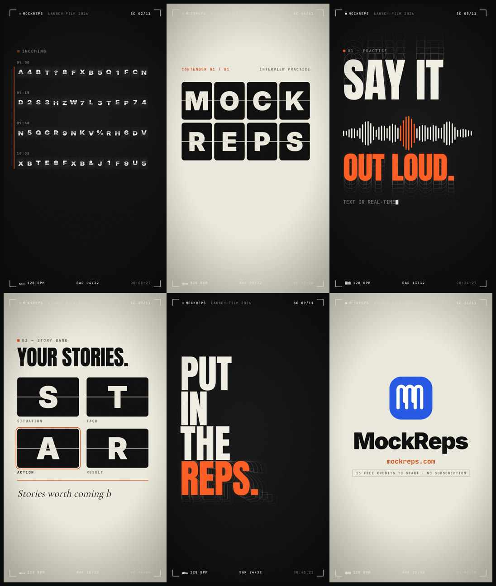

# broadcast-launch-film

A [Claude Code](https://claude.com/claude-code) skill that makes a cinematic, broadcast-title style
**launch film** for any product, cut hard to the beat of a music track. It needs no screenshots and no voice-over.



*Stills from the 60-second [MockReps](https://mockreps.com) launch film this skill was built from.*

## The look

- **Grounds:** ink and warm paper, with film grain and one hot accent colour.
- **HUD frame:** corner brackets and mono metadata, plus a live BPM meter, bar counter and timecode, all ticking with the music.
- **Kinetic type:** huge type, split-flap letter tiles, outline echo type, RGB-split glitches and serif italic accent lines.
- **Timing:** every scene starts exactly on a beat; the brand lands on the drop and the logo on the final hit.
- **Output:** renders at **60fps** by default, in 9:16, 16:9, 1:1 or 4:5.

### Four more looks (no HUD)

- **Pop Flash:** a loud, flashing, multi-colour hype reel with giant type, split panels and marquee bands. Photosensitivity-safe, with at most one full-screen change per beat.
- **The product performs:** a calm, premium film where true-size product UI is operated by a pointer. Art direction comes from `design-taste-frontend`.
- **Gym physical:** a metaphor made physical (barbell, plates, chalk, LED counter).
- **Fitness app:** the same metaphor told through premium app UI: activity rings, pickers, toggles, live graphs.

Any approved film can be recut for another aspect ratio (for example 9:16 to 16:9 for LinkedIn) with the same timing and sound.

## Install

The skill builds on the [HyperFrames](https://hyperframes.heygen.com) skills and CLI. Install those
first, then clone this repo into your Claude Code skills folder:

```bash
npx hyperframes skills
```

```bash
git clone https://github.com/danushkastanley/broadcast-launch-film.git ~/.claude/skills/broadcast-launch-film
```

Restart Claude Code. The skill then appears as `/broadcast-launch-film`.

### Requirements

- **Node.js 22+**, for the global `WebSocket` used by the safe-zone audit.
- **ffmpeg / ffprobe** on your `PATH`.
- **Google Chrome or Chromium**, for headless checks. Set `CHROME_PATH` if it isn't in a standard location.
- **A HeyGen account signed in to the HyperFrames CLI** (`npx hyperframes auth login`), for music and sound-effect retrieval from the HeyGen library.
- These HyperFrames skills, installed by `npx hyperframes skills`:
  - `product-launch-video`, whose packet, assembly and audio scripts are reused;
  - `media-use`, for the HeyGen library client;
  - `hyperframes`, `hyperframes-core`, `hyperframes-animation` and `hyperframes-creative`.

## Use

Ask Claude Code for a launch film, for example *"make a 60 second launch film for acme.com"*, or run
`/broadcast-launch-film`. It asks **one** question, the aspect ratio, and states its defaults: 60fps,
about 60s, ink and signal orange, music with SFX, no voice. Then it:

1. **Grounds the copy** in the product's own site, so only real claims appear on screen.
2. **Picks the music first.** It searches the library, downloads candidates, and reads each one's beat grid and sections.
3. **Writes a storyboard** whose every scene starts on a beat, using the design system in `assets/frame.broadcast-ink.md`.
4. **Builds the scenes** with parallel sub-agents, adds the HUD overlay, and places sound effects on the grid.
5. **Verifies** with lint, `check`, contact sheets and a safe-zone audit, then asks "render now, or what changes?".
6. **Renders a 60fps master.** `scripts/deliver.sh` makes a smaller upload copy if you want one.

## What's inside

| Path | What it is |
|---|---|
| `SKILL.md` | The workflow Claude follows |
| `references/` | Looks, design system, story arc and scene grammar, SFX placement, QA gotchas |
| `assets/frame.broadcast-ink.md` | Design spec template: palette, type roles, components, motion rules |
| `assets/frame.{pop-flash,product-performs,gym-physical,fitness-app}.md` | Templates for the four no-HUD looks (placeholder colours to remap) |
| `assets/chrome.template.html` | The HUD and film-grain overlay |
| `assets/fonts/` | Anton, Inter, Cormorant Garamond, JetBrains Mono (SIL OFL 1.1, licences included) |
| `scripts/music.mjs` | Search and download tracks from the HeyGen music library |
| `scripts/music-grid.mjs` | Beat grid, BPM and section map for a track |
| `scripts/music-bands.mjs` / `kick-grid.mjs` / `music-env.mjs` | Low/high-band section map, exact kick-fitted beat grid, and a 10 ms envelope to pin a hit or a stop |
| `scripts/make-chrome.mjs` / `mount-chrome.mjs` | Generate the HUD from `film.json` and mount it over every scene at the film's fps |
| `scripts/text-audit.mjs` | Seek the whole film and flag text outside the safe zone |
| `scripts/deliver.sh` | Optional upload copy: capped bitrate, −14 LUFS |

## Licence

The skill is MIT; see [LICENSE](LICENSE). The bundled fonts are under the SIL Open Font License 1.1; see
`assets/fonts/OFL-*.txt`. Music and sound effects are not included: they are retrieved from the
HeyGen library under your own account's terms.
